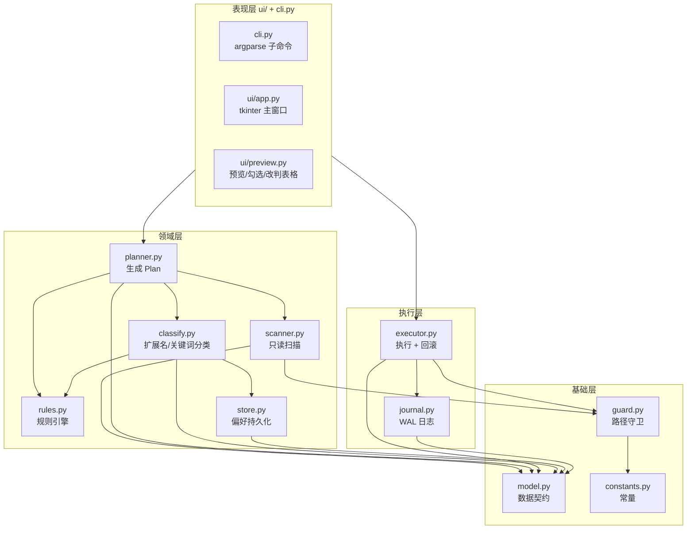
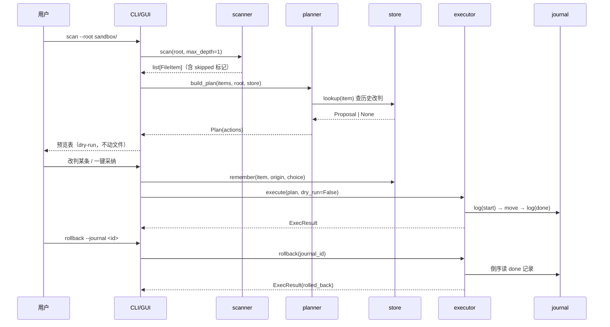

# M2 架构设计与接口契约 v0.1

> 冻结日期：2026-11-02 | 契约变更必须同步本文件 + 契约测试

## 1. 分层架构



## 2. 数据流



## 3. 目录层级策略

```
<目标根>/
├── 图片/
│   ├── 重要/     # 近期 + 高置信类别
│   ├── 常用/
│   └── 归档/
├── 文档/{重要,常用,归档}
├── ...（13 类）
└── 其他/          # 低置信兜底
```

一级按类别（13 类），二级按重要度（3 档）。**不生成三级**——桌面整理过度分层反而更难找。

## 4. 接口契约（冻结）

### 4.1 基础类型（model.py）

```python
@dataclass FileItem(path, name, ext, size, mtime, atime, is_dir,
                     readonly, cloud_placeholder, skipped_reason)

@dataclass Proposal(path, target_dir, category, importance, confidence, reasons, rule_id)

@dataclass PlanAction(action_id, src, dst, kind="move", reason="")

@dataclass Plan(plan_id, root, created_at, actions, warnings)

@dataclass ExecResult(ok, applied, skipped, failed, errors, journal_id, rolled_back)

class GuardError(PermissionError)
```

### 4.2 函数签名（冻结）

```python
# guard.py
check_path(path, *, allow_user_dirs=None) -> GuardResult(allowed, reason, resolved, tier)
is_safe(path, *, allow_user_dirs=None) -> bool
assert_safe(path, *, allow_user_dirs=None) -> str   # 返回 resolved，被拒抛 GuardError

# scanner.py
scan(root: str, *, max_depth: int = 1, follow_symlinks: bool = False) -> list[FileItem]

# classify.py
classify(item: FileItem, store: PreferenceStore | None = None) -> Proposal

# rules.py
match(item: FileItem) -> Rule | None

# store.py
PreferenceStore(path=None)
  .load() / .save() / .remember(item, proposal, user_choice)
  .lookup(item) -> Proposal | None
  .export_rules() -> list[dict]

# planner.py
build_plan(items, root, store=None) -> Plan

# journal.py
new_journal(root: str) -> str
log(journal_id, seq, op, src, dst, status, error="") -> None
load(journal_id) -> list[dict]
list_journals() -> list[str]

# executor.py
execute(plan: Plan, *, dry_run: bool = True) -> ExecResult
rollback(journal_id: str) -> ExecResult
```

### 4.3 不变式

| ID | 不变式 | 守护者 |
|---|---|---|
| INV1 | `DEFAULT_DRY_RUN is True` | test_contracts |
| INV2 | `ALLOW_USER_DIRS is False` | test_contracts |
| INV3 | 任何写盘前调用 `assert_safe` | test_redteam |
| INV4 | 目标已存在时不覆盖，自动改名 | test_executor |
| INV5 | journal 写 start 在执行之前 | test_journal |
| INV6 | plan 里不出现 skipped 条目 | test_planner |
| INV7 | 模块间不传裸 dict / 裸元组 | 代码审查 |

## 5. 失败矩阵

| 场景 | 检测 | 处理 | 用户可见结果 |
|---|---|---|---|
| 目标目录无写权限 | 执行时 OSError | 该条 failed，继续其它 | errors 列表 |
| 源文件被占用 | WinError 32 | failed，不重试 | 提示"文件被占用，请关闭后重试" |
| 目标同名 | dst 存在 | 自动追加 ` (n)` | reason 中记录实际路径 |
| 跨盘移动 | 盘符不同 | shutil.move（copy2+unlink） | 正常 |
| 云占位 | 文件属性 0x1000/0x400000 | 扫描期跳过 | skipped 列表 |
| 超长路径 | len > 260 | `\\?\` 前缀 | 正常或 failed |
| 进程被杀 | journal 有 start 无 done | rollback 依据 done 记录恢复 | journal 状态提示 |
| 磁盘满 | OSError | failed + 回滚已完成的 | errors |
| 源已不存在 | FileNotFoundError | skipped（可能是并发删除） | skipped 列表 |
| guard 拒绝 | GuardResult.allowed=False | 直接抛出，整条失败 | GuardError.reason |

## 6. 模块依赖方向（单向，禁止反向 import）

```
cli/ui → planner → classify/rules/store → model/constants
cli/ui → executor → journal → model
scanner → guard → constants
```

`guard` 不 import 任何业务模块；`model`/`constants` 不 import 任何项目模块。
